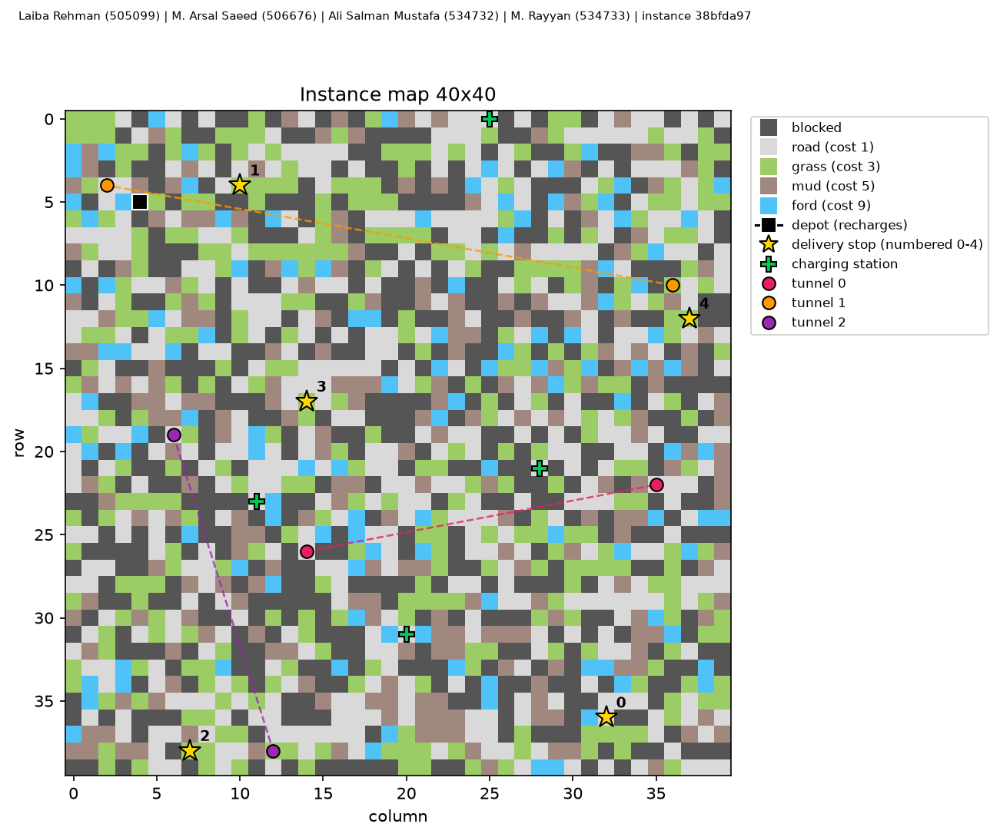
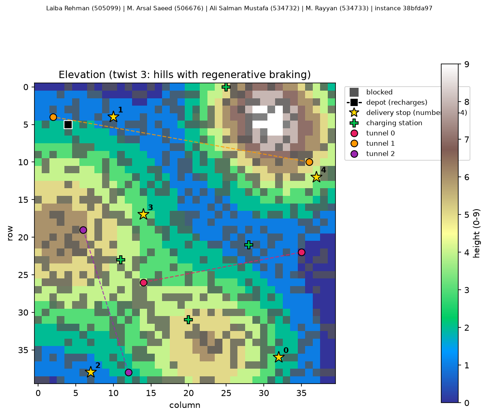

# Ridgeline Courier

_Laiba Rehman (505099) | M. Arsal Saeed (506676) | Ali Salman Mustafa (534732) | M. Rayyan (534733) | instance 38bfda97_

CS-370 Artificial Intelligence, Open-Ended Lab. An autonomous delivery agent on a hilly 40x40 city
must deliver 5 parcels from its depot. It has to deal with mixed terrain, blocked cells, slippery
moves, a limited fuel tank, teleport tunnels and a rival "blocker" agent. We implement classical
search planners, adversarial search against the rival, an LLM dispatcher that calls our planners as
tools, and a UI with reproducible, stamped experiments.

## Team

| Name | CMS ID | Owns |
|---|---|---|
| M. Arsal Saeed | 506676 | Repo setup + shared base, Part D (LLM dispatcher), Part E (UI, run_all.py), final assembly |
| Laiba Rehman | 505099 | Part B (uninformed + informed search, heuristic, experiments) |
| Ali Salman Mustafa | 534732 | Part C (Minimax, Alpha-Beta, tournament) |
| M. Rayyan | 534733 | Part A (cost map, PEAS, environment), ethics, IEEE report |

## Our instance: `38bfda97`

| Item | Value |
|---|---|
| Grid | 40x40, obstacle density 0.285 |
| Terrain cost (cost of the cell entered) | road 1, grass 3, mud 5, ford 9 |
| Start / depot | (5, 4) |
| Delivery stops (numbered 0-4) | (36,32), (4,10), (38,7), (17,14), (12,37) |
| Rival | blocker, search depth 6 |
| Slip probability | 0.25 |

### Twists

1. **Fuel limit with charging stations** (assigned). Capacity 98. Fuel burned per move: road 1, grass 1, mud 2, ford 3. Stations at (23,11), (0,25), (21,28), (31,20); the depot also recharges.
2. **Teleport tunnels** (assigned). These are bidirectional: (26,14)↔(22,35), (10,36)↔(4,2), (19,6)↔(38,12). A jump costs 2 and burns 1 fuel.
3. **Hills with regenerative braking** (ours). Each cell has an integer height from 0 to 9. Climbing `dh` units adds `2·dh` to the path cost and `3·dh` to the fuel burned. Descending `dh` units recovers `1·dh` fuel. Because regen (1) is less than the uphill fuel cost (3), no loop can create fuel.




## Setup

```bash
python -m venv venv
# Windows:  venv\Scripts\activate      macOS/Linux:  source venv/bin/activate
pip install -r requirements.txt
cp .env.example .env    # then put your Groq key in .env (optional: cached LLM replies are used otherwise)
```

## How to run

```bash
python run_all.py            # rebuild every figure/table in results/
python run_all.py --quick    # fast version (< 5 min), used for the viva live change
python run_all.py --quick --slip 0.5 --stop 2=14,23 --no-tunnels --no-hills   # live-change example
streamlit run ui/app.py      # interactive UI
pytest -q                    # tests
```

CLI flags: `--quick`, `--slip FLOAT`, `--stop IDX=R,C` (repeatable), `--rival-depth INT`,
`--fuel-capacity INT`, `--no-fuel`, `--no-tunnels`, `--no-hills`, `--seed INT`.

The data files can be regenerated exactly (they are deterministic):

```bash
cd data && python ../scripts/oel_instance.py 505099 506676 534732 534733 > instance_38bfda97.json && cd ..
python scripts/make_twists.py
python scripts/make_elevation.py
```

## Repository layout

```
oel/
  config.py         # instance + twists + elevation + CLI overrides; MEMBERS, BASE_SEED, hill constants
  stamp.py          # stamp(), save_fig(), save_table(), get_logger()
  world/            # Part A: grid + cost map, DeliveryProblem, simulator, shared map plots
  search/           # Part B: uninformed, informed, heuristics, SearchResult
  game/             # Part C: local game window, minimax / alpha-beta, evaluation, tournament
  llm/              # Part D: tools, validator, agent, cached LLM replies
  experiments/      # one script per report table/figure
ui/app.py           # Streamlit UI
scripts/            # oel_instance.py, make_twists.py, make_elevation.py
data/               # grid, instance, twists, elevation (read-only)
results/            # generated outputs: figures/, tables/, logs/, manifest.json
report/             # report section drafts
docs/               # OEL brief, viva notes
tests/              # pytest
HANDOFF.md          # turn-by-turn log
run_all.py          # one command for all results
```
